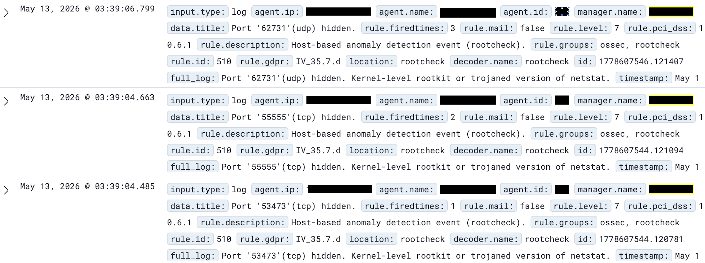
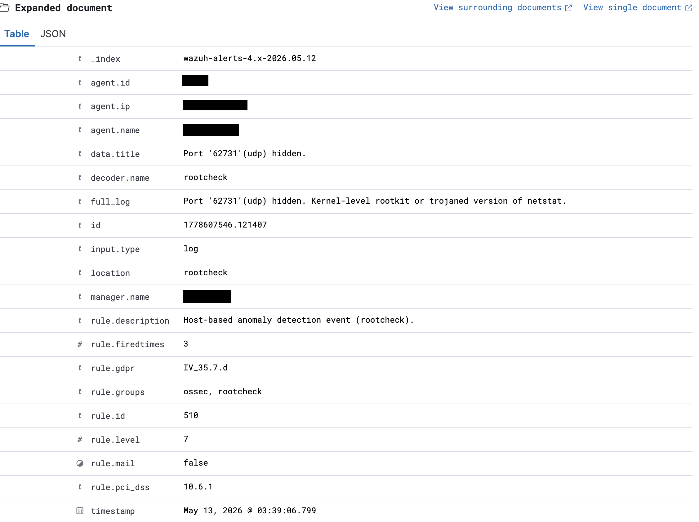
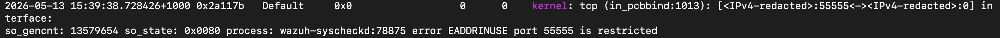
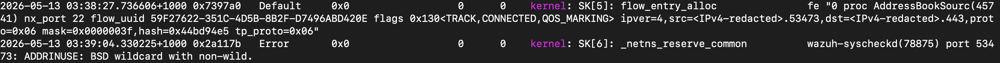

# Incident Response Report: IR-001 - Wazuh Rootcheck False Positive - macOS Agent

**Date:** 13/05/2026 

**Analyst:**  hsec-1

**Status:** Closed  

**Severity:** Informational

**Classification:** False Positive  

**Environment:** Personal device

---

## Summary

Wazuh alert triggered indicating potential active compromise with hidden ports and a kernel level rootkit or trojaned netstat. These alerts were triggered by the Wazuh rootcheck function. Rootcheck compares netstat ports in use with a manual binding attempt on all ports. The discrepancy between netstat and ports in use is what triggers the alert. The discrepancy is caused by ports in use by macOS that are not reported through netstat. These ports are either reserved or already bound but not reported through netstat.

---

## 1. Detection
**Detected By:** Wazuh alert

**Detection Time:** May 13, 2026 @ 03:39:06.799 

**Alert/Ticket ID:**  1778607546.121407

**Initial Indicator:** Alert




<br>




---

## 2. Timeline

|Date | Time | Event |
|---|---|---|
|13-05-2026 |10:00| Alerts checked |
|13-05-2026 |10:05| Investigation begins |
|13-05-2026 |10:30| Confirmed false positive |
|13-05-2026 |10:50| Detection rules altered |
|13-05-2026 |11:00| Documentation |
|13-05-2026 |13:00| Closed |

--- 

## 3. Investigation
a) Checked macOS System Integrity Protection status - returned 'enabled'. A real rootkit would likely disable it.

b) Compared lsof against netstat - both matched and no hidden ports were found. The ports in question (55555, 53473, 62731) were not open at the time I checked.

c) Queried the macOS kernel logs for ports 55555, 53473 and 62731 to find out why each bind attempt failed during the rootcheck scan. Confirmed that ports 53473 and 62731 are reused by multiple apps.

All 3 of the above ports reported EADDRINUSE when Wazuh rootcheck ran and were not listed in netstat, causing the alerts.

---

## 4. Root Cause
There are two separate root causes for these alerts. Both can be seen in the macOS kernel log at the time of the rootcheck scan.

Reason 1 - Port 55555

macOS restricts port 55555. When rootcheck attempted to bind to it, the kernel refused the bind and returned 'EADDRINUSE', which is the same error returned when a port is in use. Rootcheck interpreted this as an open port, but nothing was actually using it, so there was nothing for netstat to report and the mismatch triggered the alert.



<br>
<br>

Reason 2 - Ports 53473 and 62731

These ports were in use by short lived macOS connections when rootcheck attempted to bind to them. The kernel log shows that AddressBookSourceAgent had an outbound connection on port 53473, 37 seconds before the rootcheck scan. These are high range ports that macOS assigns and reuses for temporary connections. The bind attempt failed because the port was in use, but the connection was not listed in netstat, so rootcheck flagged the port as hidden.




---

## 5. Detection rule changes

New local rule implemented to reduce the known false positive on port 55555. Added the following rule to Wazuh local_rules.xml within the 'rootcheck' group.

```
<rule id="100002" level="0"> 
    <if_sid>510</if_sid>  
    <match>Port '55555'(tcp) hidden</match> 
    <description>False positive: wazuh-syscheckd attempts to bind to macOS restricted port 55555 during rootcheck scan. Confirmed via kernel log. </description>
</rule>

```

False positives on other random ports used for temporary connections by macOS will still trigger. This is a known limitation of this approach, but it was accepted to avoid suppressing potential genuine indicators.


--- 

## 6. Recommendations

Recommend setting a rule that triggers based on detection frequency on the same port over a set period of time, limited to high range ports (49152-65535), leaving lower range well known ports on standard detection rules.

The random high range ports cannot be suppressed without also suppressing potential real alerts. If the alert only triggers when the same port remains hidden across multiple scans, it reduces the noise and increases the likelihood of capturing a real attacker using that port to issue commands or exfiltrate data.

The rule I implemented applies to every agent, not just the MacBook, so a genuinely hidden port 55555 on another device would be suppressed as well. If I were to redeploy it, I would limit the rule and only apply it to devices running macOS using `<location>` and specifying each agent name. I have since removed Wazuh from my lab so I haven't been able to test this. 

```
<group name="rootcheck,">
  <rule id="100002" level="0">
    <if_sid>510</if_sid>
    <location>(macos-endpoint)</location>
    <field name="title" type="pcre2">^Port '55555'\(tcp\) hidden\.$</field>
    <description>False positive: macOS restricts port 55555, so the rootcheck bind attempt fails with EADDRINUSE and the port is reported as hidden. Confirmed via kernel log.</description>
  </rule>
</group>
```

---

## Skills Demonstrated

`Wazuh` `Alert triage` `False positive analysis` `Alert tuning` `macOS`

---

[← Back to Portfolio](../README.md)
