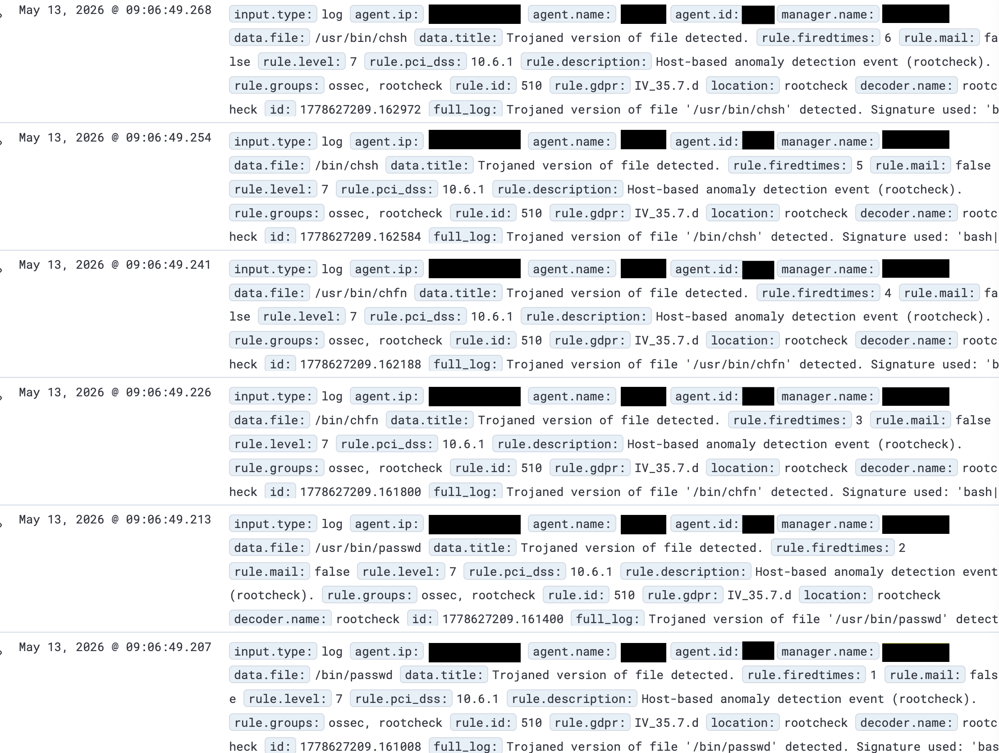
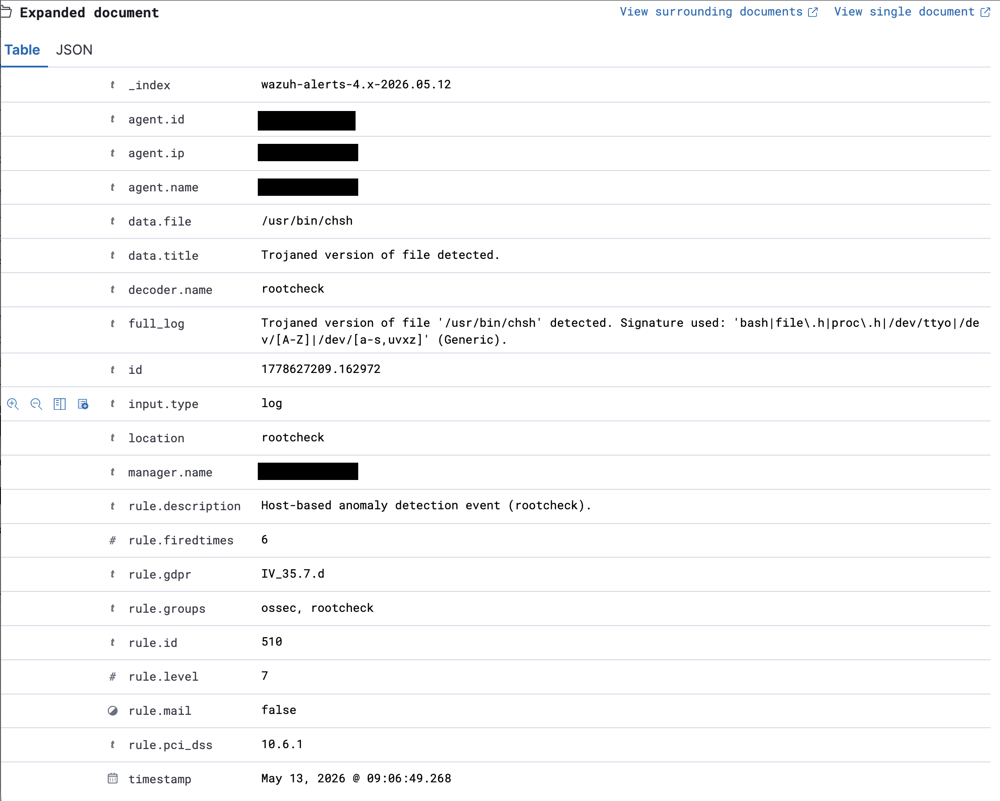

# Incident Response Report: IR-002 - Wazuh Rootcheck False Positive - Proxmox host

**Date:** 14/05/2026 

**Analyst:**  hsec-1

**Status:** Closed  

**Severity:** Informational

**Classification:** False Positive  

**Environment:** Homelab

---

## Summary

Wazuh alert triggered indicating potentially trojaned binaries on monitored Proxmox host. Confirmed false positive - the rootcheck signature matched '/dev/null', which is contained in legitimate binaries.

---

## 1. Detection
**Detected By:** Wazuh alert

**Detection Time:** May 13, 2026 @ 09:06:49.207

**Alert/Ticket ID:**  1778627209.161008

**Initial Indicator:** Alert




<br>



---

## 2. Timeline

|Date | Time | Event |
|---|---|---|
|13-05-2026 |13:00| Alerts checked |
|13-05-2026 |13:05| Investigation begins |
|13-05-2026 |13:30| Confirmed false positive |
|13-05-2026 |13:50| Detection rules altered |
|14-05-2026 |13:00| Documentation |
|14-05-2026 |15:00| Closed |

--- 

## 3. Investigation
a) I checked the flagged files ('passwd', 'chsh' and 'chfn') with dpkg to confirm they belong to the 'passwd' package and had not been modified.

b) The six alerts were triggered by three files. I discovered that each file was flagged twice because '/bin' and '/usr/bin' point to the same files on this host.

c) I searched for strings matching the rootcheck signature inside the flagged files. I could only find '/dev/null', which matched '/dev/[a-s,uvxz]' with '/dev/n'.

---

## 4. Root Cause
Rootcheck scans binaries for strings that match its library of known trojan signatures, or in this case a pattern that matches the signature ('/dev/[a-s,uvxz]'). Because the 'n' in '/dev/null' falls between 'a' and 's', the rule is triggered and an alert is created. The use of '/dev/null' is completely normal for discarding unneeded data within Unix systems and is benign.

---

## 5. Detection rule changes

I added local rules to suppress these false positive trojan detections. I found that the rules as I originally wrote them did not correctly suppress the alerts. I had tried to limit them to the Proxmox host using `<field name="agent.name">`, but the `<field>` option only checks fields extracted by the decoder, and for rootcheck events agent.name is not extracted.

The corrected rule below limits the suppression to the Proxmox host using `<location>` (for agent events, Wazuh includes the agent name in the location), and to the three flagged files and their '/bin' paths using the 'file' field. I have since removed Wazuh from my lab, so I have not been able to test this version.

```
<group name="rootcheck,">
  <rule id="100003" level="0">
    <if_sid>510</if_sid>
    <location>(proxmox-host)</location>
    <field name="file" type="pcre2">^/(usr/)?bin/(passwd|chfn|chsh)$</field>
    <description>False positive: rootcheck signature '/dev/[a-s,uvxz]' matches '/dev/null' in legitimate binaries. Syscheck provides a compensating control. dpkg --verify confirmed the binaries are unmodified.</description>
  </rule>
</group>
```

---

## 6. Compensating Control

I believe my decision to suppress these alerts is justified due to a compensating control. Syscheck, Wazuh's file integrity monitoring, monitors '/usr/bin' for any changes every 12 hours plus a scan on start. If these files were tampered with, syscheck would still alert even though the rootcheck alert is suppressed.

---

## Skills Demonstrated

`Wazuh` `Alert triage` `False positive analysis` `Compensating controls` `Linux`

---

[← Back to Portfolio](../README.md)
